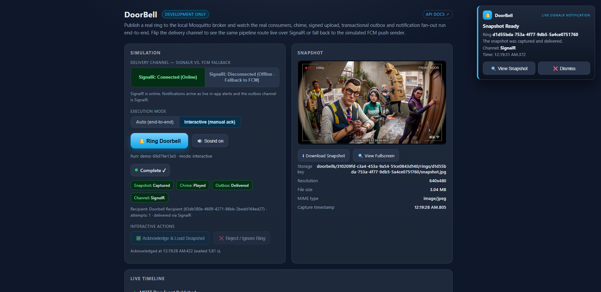
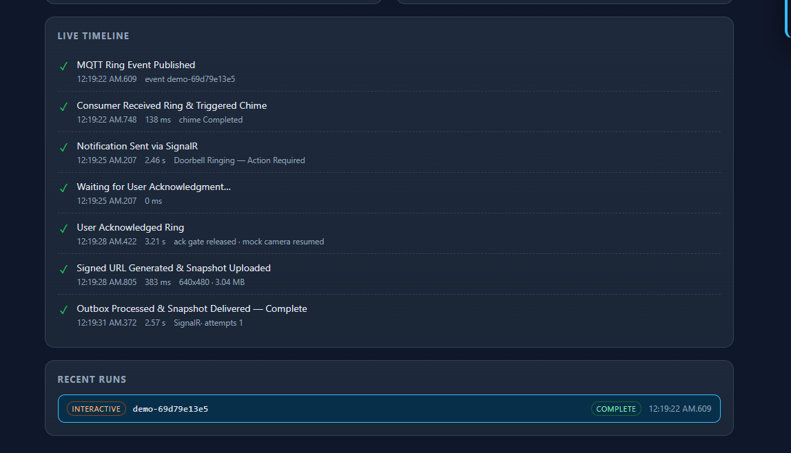

<div align="center">

# 🔔 Smart Doorbell

**An event-driven backend that keeps working when devices, networks and servers don't.**


</div>

---

## What it does

Someone presses the doorbell. The backend asks the **camera** for a snapshot, asks the **chime** to play, notifies the **owner** (live over SignalR, or push via FCM if offline), and lets the owner **acknowledge** the ring.

The interesting part: **every step survives duplicate messages, crashes, silent devices and concurrent workers.**

---

## Project flow


**How to read it**

1. **Ingest and guard:** bad payloads go to a dead-letter topic; duplicates are recognised and dropped safely.
2. **Record the intent first:** commands and the notification row are saved in one transaction *before* anything is published.
3. **Device round trip:** the camera uploads straight to a signed URL, so the photo never travels through MQTT.
4. **Safety nets:** a silent device can never leave a ring hanging. The snapshot times out, and the chime becomes `Unknown` (not `Failed`).
5. **Notify and acknowledge:** the outbox job delivers over SignalR, falls back to FCM, retries, and records every attempt.

---

## See it run

The built-in demo page drives the **real pipeline**: real MQTT broker, real consumers, real orchestration, real signed upload. Only the camera and chime are simulated.

### The dashboard

<div align="center">

</div>

| On screen | What it means |
|---|---|
| **🔔 Ring Doorbell** | Publishes a real ring message to the local MQTT broker. This is the only input. |
| **Run: `demo-…`** | The run id doubles as the ring's `eventId`, so every command id reads `demo-…:snapshot` / `demo-…:chime`. |
| **Complete ✓** | The whole pipeline finished (other states: Idle, In progress, Failed). |
| **Snapshot: Captured** · **Chime: Played** | The two device state machines reached their happy end state. |
| **Outbox: Sent** · **SignalR: Received** | The notification row was delivered, and the browser actually received the live push. |
| **Recipient … attempts: 1 · sent via SignalR** | Read straight from the attempt history: who was notified, how many tries, which channel. |
| **✅ Acknowledge ring** | Calls the JWT-protected `POST /api/doorbells/rings/{id}/acknowledge` as the owner. |
| **📱 Register / 🗑️ Remove demo FCM token** | Registers a fake push token. With no live SignalR connection the outbox routes to **FCM**, and reports honestly if Firebase isn't configured. |
| **🔊 Sound on** | Plays a doorbell chime in the browser the moment you click Ring. Toggle to mute. |
| **Snapshot panel** | The photo the camera uploaded, with its storage key (`doorbells/{deviceId}/rings/{ringEventId}/snapshot.jpg`) and resolution. |

### The timeline

<div align="center">

</div>

| Timeline step | What actually happened |
|---|---|
| **Ring published to MQTT** | The button publishes to `devices/{id}/doorbell/ring` (QoS 1). |
| **Ring event persisted & orchestrated** | The event is stored **once** (unique per device + event id). Commands are **saved first**, then published. |
| **Snapshot command sent** | The camera receives `…:snapshot` with a **signed, 5-minute upload URL**. |
| **Camera upload & snapshot result** | The camera `PUT`s the photo straight to storage, then reports its resolution. Ring becomes `Captured`. |
| **Chime command sent / acknowledged** | The chime plays the melody and acks. Ring becomes `Played`. |
| **Notification created** | An **outbox row** was persisted in the same transaction as the commands, so the alert can't be lost. |
| **Notification sent** | Delivered over **SignalR** on the first attempt. With no live connection it falls back to **FCM**. |

---

## Built for the unhappy path

| When this happens… | …the system does this |
|---|---|
| The same ring is delivered twice | **One** event, **one** snapshot command, **one** chime command |
| The server dies after saving, before publishing | The **intent is already in the DB**; deterministic IDs (`{eventId}:snapshot`) make replays safe |
| A device sends garbage | **Dead-lettered** to `<topic>/dlq` and acked, so it can't block the queue |
| Processing fails | Message **not acked**, so the broker redelivers (at-least-once) |
| The camera never answers | Snapshot becomes `TimedOut` |
| The chime never acks | Becomes `Unknown`, **not** `Failed`: silence doesn't prove it didn't ring |
| Two workers grab one notification | `RowVersion` optimistic concurrency: **one wins, one backs off** |
| A worker dies mid-send | Stuck `Processing` rows are **recovered** after a timeout |
| The owner is offline | **SignalR → FCM** fallback, with full attempt history |
| The MQTT broker drops | Reconnect with **exponential backoff + jitter** |
| An upload URL leaks | HMAC-SHA256, one key + one permission, **expires in 5 min** |
| Auth is misconfigured | **Fails closed**: every token is rejected |

> **Try it:** publish `ring.json` with no device answering, and watch the snapshot go `TimedOut` and the chime `Unknown`.

---

## Design

**Clean Architecture + CQRS (MediatR):** `Api → Infrastructure → Application → Domain`. Handlers depend only on interfaces, so MQTT, storage or push can be swapped without touching business logic (e.g. local files → S3 via `IObjectStorage`). Entities have private setters and enforce their own state machines:

```text
Snapshot     NotRequested → Requested → Captured | TimedOut | Failed
Chime        NotRequested → Requested → Played   | Failed   | Unknown
Acknowledge  Pending → Acknowledged | Missed
Command      Pending → Sent → Completed | Failed → (Retry) → Pending
Outbox       Pending → Processing → Sent | Failed   (up to MaxAttempts)
```

**Stack:** .NET 10 · ASP.NET Core · MQTTnet 5 · EF Core 10 · SQL Server · MediatR · SignalR · Firebase Admin SDK · JWT · xUnit · Moq (70+ tests)

---

## Run it

**Needs:** .NET 10 SDK · SQL Server (Express / LocalDB / Docker) · MQTT 5 broker on `localhost:1883` (e.g. Mosquitto) · `dotnet-ef`

```bash
git clone https://github.com/Khaled-Elhanan/smart-doorbell.git && cd smart-doorbell

# connection string
cd src/Doorbell.Api
dotnet user-secrets set "ConnectionStrings:MyConnection" "Server=localhost,1433;Database=DoorbellDb;User Id=sa;Password=<pwd>;TrustServerCertificate=True"
cd ../..

# schema, then run (opens the demo at https://localhost:7101/demo/)
dotnet ef database update --project src/Doorbell.Infrastructure --startup-project src/Doorbell.Api
dotnet run --project src/Doorbell.Api --launch-profile https
```

Open `/demo/` and press **Ring Doorbell**. Swagger is at `http://localhost:5260` (Development only).

---


<div align="center">

**Khaled Elhanan** · [GitHub](https://github.com/Khaled-Elhanan) · [khaledabdelhanansaad@gmail.com](mailto:khaledabdelhanansaad@gmail.com)

</div>
