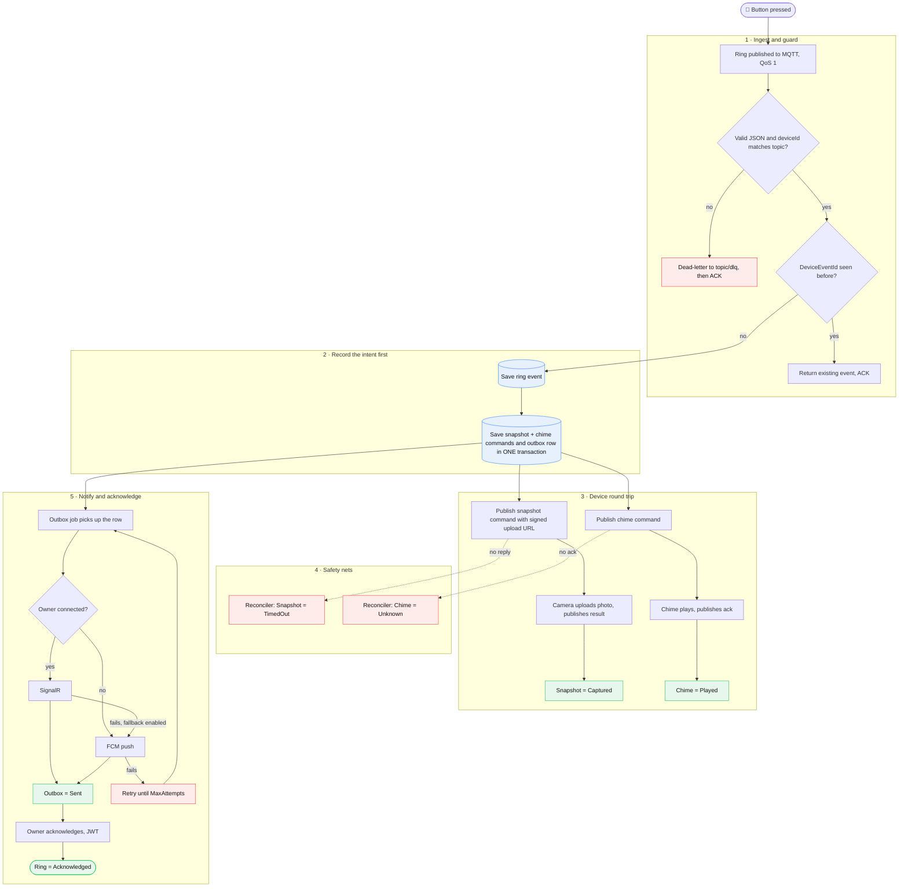

<div align="center">

# 🔔 Smart Doorbell

**An event-driven backend that keeps working when devices, networks and servers don't.**


</div>

---

## What it does

Someone presses the doorbell → the backend takes a **snapshot** from the camera, triggers the **chime**, and **notifies the owner** (live via SignalR, or push via FCM if offline). The owner can then **acknowledge** or **dismiss** the ring.

Every step is **idempotent**, **crash-safe**, and handles **silent devices**, **duplicate messages**, and **concurrent workers**.

---

## See it run

The built-in demo page runs the **real pipeline** end-to-end: real MQTT broker, real consumers, real orchestration, real signed upload. Only the camera and chime are simulated.

<div align="center">

</div>

<br>

<div align="center">

</div>

**What the demo shows:**

- **Ring Doorbell** → publishes a real MQTT message (QoS 1)
- **Snapshot: Captured** → camera uploaded photo via signed URL, resolution shown
- **Chime: Played** → chime device acknowledged
- **Outbox: Delivered** → notification sent, delivery channel and attempt count shown
- **Live Timeline** → every stage with timestamps and durations
- **Acknowledge / Dismiss** → JWT-protected, updates ring status
- **SignalR ↔ FCM toggle** → switch delivery channel and watch the fallback

---

## Pipeline flow



1. **Ingest & guard** — bad payloads → dead-letter topic; duplicates → safe dedup.
2. **Record intent** — commands + outbox saved in one transaction *before* publishing.
3. **Device round trip** — camera uploads to a signed URL (photo never travels through MQTT).
4. **Safety nets** — silent camera → `TimedOut`; silent chime → `Unknown` (not `Failed`).
5. **Notify & acknowledge** — SignalR → FCM fallback, with retry and full attempt history.

---

## Failure handling

| Scenario | Response |
|---|---|
| Same ring delivered twice | One event, one snapshot, one chime (idempotent) |
| Server crashes after save | Intent in DB + deterministic IDs → replays are safe |
| Garbage payload | Dead-lettered and ACKed |
| Camera never responds | Snapshot → `TimedOut` |
| Chime never acks | Chime → `Unknown` (silence ≠ failure) |
| Two workers grab one notification | `RowVersion` optimistic concurrency → one wins |
| Worker dies mid-send | Stuck `Processing` rows recovered after timeout |
| Owner offline | SignalR → FCM fallback |
| MQTT broker drops | Reconnect with exponential backoff + jitter |
| Upload URL leaks | HMAC-SHA256, scoped, expires in 5 min |

---

## Architecture

**Clean Architecture + CQRS (MediatR)** — `Api → Infrastructure → Application → Domain`

Handlers depend only on interfaces, so MQTT, storage, or push providers can be swapped without touching business logic. Entities enforce their own state machines:

```text
Snapshot     NotRequested → Requested → Captured | TimedOut | Failed
Chime        NotRequested → Requested → Played   | Failed   | Unknown
Acknowledge  Pending → Acknowledged | Missed
Command      Pending → Sent → Completed | Failed → (Retry) → Pending
Outbox       Pending → Processing → Sent | Failed   (up to MaxAttempts)
```

**Stack:** .NET 10 · ASP.NET Core · MQTTnet 5 · EF Core 10 · SQL Server · MediatR · SignalR · Firebase Admin SDK · JWT · xUnit · Moq (70+ tests)

---

## Getting started

**Prerequisites:** .NET 10 SDK · SQL Server · MQTT 5 broker on `localhost:1883` (e.g. Mosquitto) · `dotnet-ef`

```bash
git clone https://github.com/Khaled-Elhanan/smart-doorbell.git && cd smart-doorbell

# Set the connection string
cd src/Doorbell.Api
dotnet user-secrets set "ConnectionStrings:MyConnection" \
  "Server=localhost,1433;Database=DoorbellDb;User Id=sa;Password=<pwd>;TrustServerCertificate=True"
cd ../..

# Create database and run
dotnet ef database update --project src/Doorbell.Infrastructure --startup-project src/Doorbell.Api
dotnet run --project src/Doorbell.Api --launch-profile https
```

Open **https://localhost:7101/demo/** and press **Ring Doorbell**.
Swagger is at **http://localhost:5260** (Development only).

---

<div align="center">

**Khaled Elhanan** · [GitHub](https://github.com/Khaled-Elhanan) · [khaledabdelhanansaad@gmail.com](mailto:khaledabdelhanansaad@gmail.com)

</div>
